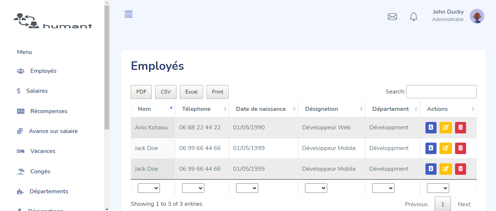

# Humant — Human Resource Management System

<p align="center">
  
</p>

<p align="center">
  <strong>Angular 11 &nbsp;·&nbsp; Spring Boot 2.5 &nbsp;·&nbsp; PostgreSQL / MySQL / SQLite</strong>
</p>

Humant is a production-ready HRMS that centralizes recruitment, employee administration, payroll workflows, compliance, and team communication in one self-hosted platform. It ships with a browser-based one-click launcher, a guided deployment-bundle generator, a full marketing kit, and offline premium documentation.

---

## Contents

- [Product Summary](#product-summary)
- [Core Features](#core-features)
- [Module Overview](#module-overview)
- [User Roles](#user-roles)
- [Quick Start](#quick-start)
  - [Option A — GUI Launcher (recommended)](#option-a--gui-launcher-recommended)
  - [Option B — Manual CLI](#option-b--manual-cli)
- [Database Configuration](#database-configuration)
- [Deployment Generator](#deployment-generator)
- [Project Structure](#project-structure)
- [npm Scripts](#npm-scripts)
- [Environment Variables](#environment-variables)
- [Marketing Assets](#marketing-assets)
- [Documentation](#documentation)
- [Screenshots](#screenshots)
- [Contact](#contact)
- [License](#license)

---

## Product Summary

| Property | Value |
|---|---|
| Product name | HUMANT |
| Type | HRMS (Human Resource Management System) |
| Frontend | Angular 11, Bootstrap 4, RxJS 6 |
| Backend | Spring Boot 2.5, Spring Data JPA, Spring Security |
| Databases | PostgreSQL (default), MySQL, SQLite |
| Default frontend port | 4201 |
| Default backend port | 8080 |
| Launcher port | 3030 |
| Deployment generator port | 3040 |

---

## Core Features

- Employee profile and master data management
- Department, designation, and organizational hierarchy
- Attendance, leave, holiday, and workforce administration
- Salary, payslip, loan, advance salary, and expense workflows
- Recruitment pipeline: jobs → candidates → pipeline → interviews → offer letters
- Contract, document, warning, complaint, notice, and termination workflows
- Training, event, onboarding, performance, and communication modules
- Role-based security with JWT-protected backend APIs
- Stripe payment integration for subscription workflows
- OpenAPI / Swagger UI at `/swagger-ui.html`

---

## Module Overview

| Category | Modules |
|---|---|
| **Organization setup** | Country, City, Department, Designation, Education Level |
| **HR configuration** | Contract Type, Leave Type, Award Type, Training Type, Termination Type |
| **Core workforce** | Employee, Contract, Document, Onboarding, Attendance, Leave, Holiday |
| **Compliance** | Warning, Complaint, Notice, Termination, Resign, Transfer |
| **Compensation** | Salary, Payslip, Loan, Advance Salary, Expense |
| **Recruitment** | Job, Candidate, Job Application, Pipeline, Interview, Offer Letter |
| **Development** | Training, Performance, Award, Event, Announcement |
| **Platform** | User, Shared configuration, Subscription, Communication |

---

## User Roles

| Role | Primary scope |
|---|---|
| Admin | Full platform — master data, users, roles, audit |
| HR Manager | Employee lifecycle, recruitment, onboarding, compliance |
| Payroll / Finance | Salary, payslip, loans, expenses, advances |
| Department Manager | Team attendance, interviews, performance input |
| Employee | Self-service — profile, leave requests, payslip view |

---

## Quick Start

### Prerequisites

| Tool | Required version | Purpose |
|---|---|---|
| Node.js | 14.x or 16.x | Angular 11 and launcher scripts |
| npm | 6+ or 8+ | Frontend package management |
| Java | 11 | Spring Boot backend |
| PostgreSQL | 12+ | Default runtime database |

---

### Option A — GUI Launcher (recommended)

The launcher is a zero-dependency Node.js server with a 4-step browser wizard.

**Windows:**

```bat
launcher.bat
```

**macOS / Linux:**

```bash
./launcher.sh
```

Then open **http://localhost:3030** and follow the wizard:

1. **Requirements Check** — checks Node, npm, Java, Git; offers auto-install via Winget / Homebrew / apt.
2. **Setup Database** — select SQLite, PostgreSQL, or MySQL; enter credentials; saves to `backend/launcher-config.json`.
3. **Install Packages** — runs `npm install --legacy-peer-deps` with a live progress bar.
4. **Launch Centers** — starts the Spring Boot backend (port 8080) and Angular frontend (port 4201) simultaneously.

```bash
# Or start the launcher directly:
npm run launcher
```

---

### Option B — Manual CLI

**1. Install frontend dependencies**

```bash
npm install --legacy-peer-deps
```

> `--legacy-peer-deps` is required because `angular-datatables@10` has a peer dependency conflict with Angular 11 on npm 7+.

**2. Create the database**

```sql
CREATE DATABASE humant;
```

**3. Start the backend**

```powershell
# Windows
Push-Location .\backend
.\mvnw.cmd spring-boot:run
```

```bash
# macOS / Linux
cd backend
./mvnw spring-boot:run
```

Backend starts at **http://localhost:8080**.

**4. Start the frontend**

```bash
npm run serve -- --port 4201
```

Frontend starts at **http://localhost:4201**.

---

## Database Configuration

The backend reads database settings from environment variables with PostgreSQL defaults:

| Variable | Default | Description |
|---|---|---|
| `HUMANT_DATASOURCE_URL` | `jdbc:postgresql://localhost:5432/humant` | JDBC connection URL |
| `HUMANT_DATASOURCE_USERNAME` | `postgres` | Database username |
| `HUMANT_DATASOURCE_PASSWORD` | `admin` | Database password |
| `HUMANT_DATASOURCE_DRIVER` | `org.postgresql.Driver` | JDBC driver class |
| `HUMANT_JPA_DIALECT` | `org.hibernate.dialect.PostgreSQLDialect` | Hibernate dialect |

The GUI launcher sets these variables automatically based on the dialect you select in Step 2.

**SQLite** (zero-config for local use):

```
HUMANT_DATASOURCE_URL=jdbc:sqlite:./humant.db
HUMANT_DATASOURCE_DRIVER=org.sqlite.JDBC
HUMANT_JPA_DIALECT=org.sqlite.hibernate.dialect.SQLiteDialect
```

**MySQL:**

```
HUMANT_DATASOURCE_URL=jdbc:mysql://localhost:3306/humant?useSSL=false&serverTimezone=UTC
HUMANT_DATASOURCE_DRIVER=com.mysql.cj.jdbc.Driver
HUMANT_JPA_DIALECT=org.hibernate.dialect.MySQL5InnoDBDialect
```

Static defaults can also be edited in `backend/src/main/resources/application.properties`.

---

## Deployment Generator

The deployment generator builds a self-contained bundle ready for any JVM-capable server.

**Windows:**

```bat
generate-deployment-version.bat
```

**macOS / Linux:**

```bash
./generate-deployment-version.sh
```

Or from npm:

```bash
npm run generate:deployment
```

Opens a browser UI at **http://localhost:3040**. The generator:

1. Builds the Angular production bundle (`npm run build`).
2. Packages the Spring Boot backend with the Maven wrapper (`mvnw -DskipTests package`).
3. Writes `config/application-production.properties` from your form inputs.
4. Exports `config/nginx.conf.example` — same-origin Nginx reverse proxy config for `/api`.
5. Creates `start-backend.bat` and `start-backend.sh` for the packaged JAR.
6. Saves a `deployment-manifest.json` with build metadata.

Output is placed in `deployment-builds/<deployment-name>/`.

**Recommended production topology:**

```
Nginx (port 80/443)
  ├── / → frontend/        (Angular static files)
  └── /api/ → :8080        (Spring Boot JAR)
```

---

## Project Structure

```
humant/
├── backend/                    Spring Boot application
│   ├── src/main/java/          Java source (controllers, services, models)
│   ├── src/main/resources/     application.properties, data.sql
│   ├── mvnw / mvnw.cmd         Maven wrapper
│   └── pom.xml                 Maven build file
├── src/                        Angular 11 application root
│   ├── app/
│   │   ├── main/               Shared configs, services, URL base
│   │   └── modules/            Feature modules (employee, leave, salary, …)
│   └── assets/                 CSS, images, vendor libraries
├── marketing/                  Marketing HTML assets + Playwright capture scripts
├── premium-docs/               Offline documentation site
├── docs/                       Module and role-based user guides
├── screenshots/                Product screenshots
├── launcher.js                 GUI launcher server (port 3030)
├── launcher.bat                Windows launcher entry point
├── launcher.sh                 macOS/Linux launcher entry point
├── generate-deployment-version.js     Deployment generator server (port 3040)
├── generate-deployment-version.bat    Windows generator entry point
├── generate-deployment-version.sh     macOS/Linux generator entry point
├── proxy.conf.json             Angular dev proxy (forwards /api → :8080)
├── server.js                   Express static server for Angular dist
├── angular.json                Angular CLI workspace config
└── package.json                Frontend dependencies and scripts
```

---

## npm Scripts

| Script | Command | Description |
|---|---|---|
| `npm run launcher` | `node launcher.js` | Start the GUI launcher at port 3030 |
| `npm run generate:deployment` | `node generate-deployment-version.js` | Start the deployment generator at port 3040 |
| `npm run install:frontend` | `npm install --legacy-peer-deps` | Install frontend dependencies (peer-dep safe) |
| `npm run serve` | `ng serve` | Angular dev server (add `-- --port 4201`) |
| `npm run build` | `ng build` | Angular production build → `dist/my-app-angular` |
| `npm start` | `node server.js` | Serve Angular dist with Express |
| `npm test` | `ng test` | Run Angular unit tests |

---

## Environment Variables

In addition to the database variables above:

| Variable | Default | Description |
|---|---|---|
| `APP_BASE_URL` | `http://localhost:4201` | Public base URL for Stripe redirect URLs |
| `STRIPE_SECRET_KEY` | `sk_test_placeholder` | Stripe secret API key |
| `STRIPE_WEBHOOK_SECRET` | `whsec_placeholder` | Stripe webhook signing secret |
| `STRIPE_PUBLISHABLE_KEY` | `pk_test_placeholder` | Stripe publishable key |
| `HUMANT_LAUNCHER_PORT` | `3030` | Override the launcher UI port |
| `HUMANT_DEPLOYMENT_PORT` | `3040` | Override the deployment generator UI port |

---

## Marketing Assets

| File | Dimensions | Description |
|---|---|---|
| [marketing/index.html](marketing/index.html) | Full page | Multi-section marketing landing page |
| [marketing/cover-banner.html](marketing/cover-banner.html) | 590 × 300 | Marketplace cover banner |
| [marketing/poster.html](marketing/poster.html) | 1600 × 800 | Product launch poster |
| [marketing/presentation.html](marketing/presentation.html) | Full page | Pitch deck / product walkthrough |

Capture screenshots of any marketing page using the bundled Playwright scripts:

```bash
# Install Playwright (one time)
npm install --save-dev @playwright/test

# Capture full marketing page sections
node marketing/capture.js

# Capture cover banner (590x300 JPEG)
node marketing/capture_cover_banner.js

# Capture poster (1600x800 PNG + JPEG)
node marketing/capture_poster.js
```

---

## Documentation

| Resource | Description |
|---|---|
| [premium-docs/index.html](premium-docs/index.html) | Full offline docs — 20 sections with sidebar navigation |
| [docs/MODULES_USER_GUIDE.md](docs/MODULES_USER_GUIDE.md) | Module-by-module user guide and local setup runbook |
| [docs/ROLE_BASED_USER_GUIDE.md](docs/ROLE_BASED_USER_GUIDE.md) | Role-based daily workflow guide and permission matrix |

---

## Common Issues

**npm install fails with peer dependency errors**

Use `--legacy-peer-deps`:

```bash
npm install --legacy-peer-deps
```

Root cause: `angular-datatables@10` requires `@angular/common@^10.2.2` but this project uses Angular 11. The launcher applies this flag automatically in Step 3.

**Backend cannot connect to database**

1. Confirm PostgreSQL is running: `pg_isready`
2. Confirm the `humant` database exists: `psql -U postgres -c "\l"`
3. Check credentials in `backend/src/main/resources/application.properties`

**Frontend shows API errors**

Confirm the backend is running on port 8080. The Angular dev proxy at `proxy.conf.json` forwards `/api/*` to `http://localhost:8080`.

**Port already in use**

```bash
# Change the frontend port
npm run serve -- --port 4300

# Change the launcher port
HUMANT_LAUNCHER_PORT=3031 node launcher.js
```

---

## Screenshots

<p align="center">
  
</p>

---

## Contact

Email: contact@delta-dev-software.com

---

## License

[MIT License](license.txt)
